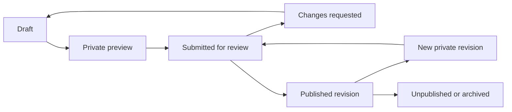

CPM Int'l publishing and administration: proposed implementation plan

Prepared 26 October 2026 against repository commit `95c2c85`. This is a planning document. No application code, infrastructure, accounts or live content were changed for this plan.

The intended outcome is that an invited member of staff can prepare an article, obtain approval and publish it from the website. Publishing should update the public article, newsroom, homepage and sitemap without a code deployment. Editing an existing article must leave its approved version visible until the replacement is published.

**Working assumptions.** The user approved proceeding with the recommended first milestone on 26 October 2026. The first release covers news, event reports, images and staff access. The institute owner initially has publishing authority; contributors prepare drafts. A Publisher role allows the owner to delegate approval later. These are the working defaults unless the user changes the scope or publishing authority. The architecture can support later modules without making them part of this first release.

**What exists today.** The public site already renders articles and SEO information on the server. The gaps are shared storage, authenticated access and a real publishing workflow.

| Area | Verified state | Work required |
| --- | --- | --- |
| Published content | `src/content/articles.json`: 10 articles, comprising 5 news stories and 5 event reports; 92 gallery entries | Import into shared storage with existing URLs and media intact |
| Draft editor | `/admin/posts` saves into browser local storage and exports JSON | Replace with authenticated editing and durable server saves |
| Publishing | Import script, code review and deployment | Add an authorized publish operation |
| Article structure | Titles, summaries, bylines, topics, structured body blocks, images, galleries and event details | Extend the existing structure with revisions and workflow fields |
| SEO | Canonical URLs, article metadata, NewsArticle/Breadcrumb markup and sitemap | Preserve these and generate them from the published database revision |
| Public consumers | Homepage, newsroom, related articles, sitemap and event redirects import the JSON collection | Move all consumers to the same published-content service |
| Identity | No authentication dependency or backend configuration found in this checkout | Configure authentication, invitations and permissions |
| Hosting | Lovable-connected repository; build configuration defaults to a Cloudflare target | Verify the actual deployment's runtime, secrets and request handling before integration |

One legacy article has no publication date. Five legacy event IDs redirect to their corresponding articles. Both details must survive migration; unknown dates must remain unknown.

**The first admin release.** Use a protected `/admin` area with a consistent navigation rail, clear page titles and ordinary forms. Carry over the institute's cream, forest green and restrained typography, using compact layouts suited to writing and reviewing. Use familiar document, image and people icons. The dashboard should show actual editorial work, without invented traffic statistics or decorative AI symbols.

| Screen | What staff can do |
| --- | --- |
| Sign in and account recovery | Accept an invitation, sign in, reset a password, set up two-factor authentication and sign out |
| Overview | See drafts, submissions awaiting review, recently published articles and recent activity within their permissions |
| Articles | Search and filter by status, type, topic and author; create, edit, preview, review, publish or archive as permitted |
| Article editor | Write content, arrange images, edit article details and SEO, see save status and submit for review |
| Review queue | Read the exact submitted version, compare changes, leave a review note, return for changes or publish |
| Media library | Upload images, add captions and credits, find existing media and see where an image is used |
| Team | Owner invites people, assigns roles and disables access |
| Activity | Owners and publishers inspect editorial changes; contributors see activity on their assigned work |
| Settings | Owner manages a small set of publisher defaults; no arbitrary website-code editor |

The Articles screen combines news and event reports. Event-specific fields appear only when that type is selected. An event report remains an article; ticket sales, registration management and a future-events calendar require a later event module.

Research pages, leadership profiles, downloadable resources, fellowship applications and donations should be separate future modules with their own permissions. Do not show empty or nonfunctional admin destinations in the first release.

**Access and ownership.** Accounts are invitation-only. There is no public staff registration. The institute owns the backend, storage, sending domain and recovery details. The first Owner is provisioned through a controlled setup step, rather than granting ownership to whoever signs up first.

| Capability | Owner | Publisher | Contributor |
| --- | --- | --- | --- |
| Create articles | Yes | Yes | Yes |
| Edit drafts | All | All | Own or assigned |
| Preview private revisions | All | All | Own or assigned |
| Upload media | Yes | Yes | For own or assigned work |
| Submit for review | Yes | Yes | Yes |
| Return submissions with a review note | Yes | Yes | No |
| Publish, replace a live version, unpublish or feature | Yes | Yes | No |
| Archive or restore articles | Yes | Yes | No |
| Invite, disable or change staff roles | Yes | No | No |
| Change publisher settings | Yes | No | No |
| Inspect all editorial activity | Yes | Yes | No |

Publisher accounts are optional initially. The owner can handle the full writing-to-publication process alone. Author bylines are independent of login accounts: a staff editor can publish an accurately credited article by a researcher or by the institute without giving that author admin access.

Require two-factor authentication for Owners and Publishers. Prevent removal or demotion of the last active Owner. Document recovery before launch. Disabling membership must stop privileged requests even if the person still has an unexpired login token. Restrict draft/media access on the server and in database policies; hiding navigation is insufficient.

**Editorial workflow.** A contributor creates a draft, writes and previews it, then submits a specific saved revision for review. The reviewer either returns it with a note or publishes that exact revision. A subsequent change invalidates the earlier submission and requires another review. Owners and Publishers can publish their own work after previewing and passing validation; a compulsory second reviewer is not assumed.

Saving and publishing are distinct actions. Autosave records draft changes after a short pause and shows Saving, Saved or Save failed. Manual Save remains available. Navigation warns about unsaved changes. A lost connection must never produce a false saved message. A version check prevents one editor from silently overwriting another editor's newer work. Real-time collaborative cursors are outside the first release.

Publishing creates an immutable revision and switches the live article to that revision atomically. The same operation records the actor, time and publication action. Repeated clicks or request retries must not create duplicate articles. Only one featured newsroom article is allowed, enforced in storage as well as the interface.

For example, if an article is already public and someone changes its headline, the old headline remains public. The new headline exists only in the draft and authenticated preview until a Publisher releases it.

Revision history lets authorized staff inspect earlier versions and restore one into a new draft. Restoring does not silently overwrite the live version. Unpublishing removes the article from public listings, related stories and sitemap while retaining internal history. Archiving removes it from the active editorial queue. Permanent deletion is excluded from routine first-release controls.

**Writing and media.** The editor should have a large writing area and a narrower details panel. Group secondary controls under Content, Details, Media, SEO and History. On small screens these become stacked panels. Keep Save, Preview and the permitted workflow action easy to find.

Support title, summary, named authors or institute byline, primary topic, News/Event report type, publication details and a structured article body. The body supports paragraphs, section headings, links, emphasis, lists, quotations and images. A gallery supports ordering, alt text and captions. Add event date and location for reports; preserve verified historical information without inventing missing details.

Use a constrained visual editor that stores validated structured JSON. Select and verify its package during the editor milestone. Staff should not need Markdown or HTML. Reuse the public article renderer for preview, and extend the renderer alongside any new block types. Reject arbitrary scripts, embedded HTML and unsafe links. Preserve references and scientific names when importing existing text.

Uploads should show progress and failure recovery. Start with JPEG, PNG and WebP images, a proposed 10 MB upload limit, verified file types and generated dimensions. Validate on the server as well as in the browser. Create web-sized derivatives through a worker-compatible processing service verified during the hosting milestone; do not assume native image-processing binaries run on Cloudflare.

Store new draft originals privately. Authorized previews use short-lived access. Publishing prepares stable public derivatives for approved media; public URLs must work for visitors and social crawlers without staff cookies. Media preparation can retry independently, and the article does not switch live until its required assets are ready. Clean up unused prepared files if publication fails. Public copies are deliberately released assets, not a guarantee that unpublishing can erase copies already downloaded elsewhere. Supabase distinguishes private access from public buckets in its [storage documentation](https://supabase.com/docs/guides/storage/buckets/fundamentals).

Use immutable file names so replacing an image cannot alter older revisions. Block deletion of assets referenced by published or retained revisions. Keep existing public gallery paths working throughout migration. Browser drafts and previews must never be added to the public media index.

**SEO belongs in the publishing workflow.** Much of the metadata generation already exists. The new admin should make these capabilities usable by staff and preserve them when the storage changes.

| Control | Proposed behavior |
| --- | --- |
| Article URL | Suggest a slug from the title; validate uniqueness against current and historical URLs; keep it stable after publication |
| SEO title and description | Default from article title and summary, with editable overrides and length guidance |
| Search and social preview | Show an approximation of supplied metadata, without claiming control over Google's final snippet |
| Cover and social image | Use the approved cover image by default; permit a dedicated share image and alt text |
| Author and dates | Preserve author identity and original publication information; distinguish event date, import date and publication date |
| Structured data | Generate NewsArticle and BreadcrumbList from the live revision; keep historical reports separate from future Event markup |
| Sitemap and related content | Read only live revisions; update when articles are published, replaced or withdrawn |
| Private pages | Authenticate admin/preview access, return noindex and prevent shared caching; noindex is an indexing instruction, not access protection |
| URL changes | Owner/Publisher action with a permanent redirect from the old address; prevent loops and reserved-slug reuse |

Validate missing titles, summaries, authors, content, required event location, invalid dates, unsafe links, duplicate slugs and missing image alt text before publication. Treat recommended metadata lengths as guidance, not arbitrary blockers. Review hints can flag bare institute abbreviations and em dashes for the site's preferred copy style, without silently rewriting quotations or names.

Use the configured public domain, `https://www.cpmintlresearchinstitute.org`, subject to a deployment check of its canonical host and redirects. Staff should never have to enter the domain for each article. Keep the publisher identity and Ibadan headquarters centrally controlled. The audit also found older "independent" wording in `src/lib/site.ts`; align that shared identity copy with the user's earlier removal request during the SEO integration milestone.

Article publication dates and modification dates should describe real editorial events; autosaving a draft must not refresh the public modified date. For new records, store timezone-aware timestamps and display editorial times in Africa/Lagos. Preserve date-only or unknown historical values during migration. These choices follow Google's [Article guidance](https://developers.google.com/search/docs/appearance/structured-data/article). Include canonical live URLs in the sitemap in line with [Google's sitemap guidance](https://developers.google.com/search/docs/crawling-indexing/sitemaps/build-sitemap). Indexing and ranking remain separate from successful publishing.

**Recommended technical approach.** Keep the existing TanStack Start website and build a tailored admin within it. Use Supabase for managed authentication, PostgreSQL content storage and image storage. This preserves the existing article design and schema while providing an institute-owned backend. Supabase documents a [TanStack Start integration](https://supabase.com/docs/guides/getting-started/quickstarts/tanstack). This is a proposed choice: first check whether the connected Lovable project already has a suitable managed backend before provisioning a second one.

Use server functions for authenticated operations and server-side public article loaders. Verify permission on every private read and mutation, with row-level policies and constrained database operations as additional enforcement. Publish must be a transaction, not several browser updates. TanStack's [server-function guidance](https://tanstack.com/start/latest/docs/framework/react/guide/server-functions) explains that route guards alone do not protect those endpoints.

Use provider-supported cookie sessions, validate sessions on the server and keep privileged provider keys exclusively in server secrets. Do not implement password hashing or authentication tokens from scratch. The current project defines `src/start.ts`, so origin/CSRF protection for new mutations must be explicitly verified and configured for the installed framework version. Auth, admin and preview responses must bypass shared caches, following the [Supabase SSR guidance](https://supabase.com/docs/guides/auth/server-side/advanced-guide).

Permissions should come from current, server-controlled membership records. A contributor must not be able to change a role, article ownership or live-revision pointer by posting extra fields. Use database grants, row policies and authorized publish procedures together, with validation at every boundary. Public reads expose only a deliberately limited published projection. Refer to [Supabase row-level security](https://supabase.com/docs/guides/database/postgres/row-level-security) when implementing and testing the policies.

| Record | Purpose and important rules |
| --- | --- |
| Staff membership | Auth user ID, role, active state, inviter and timestamps; controlled by Owner operations |
| Articles | Stable ID, canonical slug, assignment, visibility and live-revision reference; unique URL |
| Working drafts | Editable content, workflow state, version number and submitted revision reference |
| Revisions | Immutable content snapshots, author/editor attribution and publication details |
| Review entries | Exact revision submitted, reviewer decision and note |
| Media and usage | Private original, public derivatives, dimensions, credits and revision references |
| Topics | Controlled names and slugs; archive topics in use rather than breaking old articles |
| URL history | Former paths and legacy event mappings; unique aliases and loop prevention |
| Publication settings | Featured article and centrally managed publisher defaults |
| Editorial audit log | Actor, action, article/revision IDs and timestamp; users cannot rewrite their own history |

Keep the draft payload and live payload separate. Public queries must not join a working draft accidentally. Authentication account data is not public author-profile data. Shared types, formatters and renderers must not import private records into the browser bundle.

For the initial rollout, serve public article data from request-time loaders and disable shared caching for mutable article responses and the sitemap. Invalidate client query/router data after publishing. Set the acceptance target that a new public request sees the committed version immediately, without redeployment. Introduce public caching only when measured performance warrants it and invalidation is implemented for articles, lists, homepage, related stories and sitemap. Do not fall back to stale bundled JSON after migration, because that could republish an intentionally withdrawn article. Return a recoverable 503 for database outages, rather than a misleading 404.

**Implementation sequence.** Each milestone produces something reviewable before the next layer is added.

| Order | Deliverable | Completion evidence |
| --- | --- | --- |
| 1. Infrastructure and admin wireframes | Verify hosting/backend, sketch dashboard/list/editor/review screens, agree role defaults and configure isolated development/staging storage | A staff sign-in can be verified in staging; no production write access is needed for development |
| 2. Access and content foundation | Invitations, login/recovery, MFA for privileged roles, membership policies, draft/revision tables and audit operations | Permission tests deny anonymous, disabled and unauthorized users, including direct requests |
| 3. Writing and media | Server-saved editor, structured body, media uploads, conflict handling, private preview and legacy draft import | A draft saved on one device opens on another; a contributor cannot see another unassigned draft |
| 4. Review and publication | Review queue, review notes, exact-revision approval, atomic publish, update, restore and withdrawal | A published article remains unchanged while a replacement draft is edited; failed publication leaves the prior version intact |
| 5. Public integration and migration | Database-backed homepage/newsroom/article loaders, related stories, SEO, sitemap and redirects | All 10 articles, 92 gallery entries and 5 legacy mappings match the pre-migration inventory |
| 6. Staging acceptance and release | Realistic editorial walkthrough, permission tests, media/DB recovery drill, production configuration and owner handover | Owner can invite a contributor, review an article and publish it with no code deployment |

Scheduled publication, email review notifications, external expiring preview links and simultaneous collaborative editing follow the reliable manual workflow. Scheduling needs a verified server scheduler, explicit timezone handling, idempotent execution, cancellation and failure reporting; it should not be simulated with a browser timer. In-app review status and notes are enough for the first release.

**Migration and release.** First take a content inventory and export the existing collection. Run an idempotent migration in staging, retaining slugs, dates, bylines, block order, captions, image paths and legacy IDs. Validate counts and rendered pages against the current site. Import existing JSON as approved live revisions, never as editable objects accidentally exposed to the public.

Preserve local browser drafts through an authenticated Import drafts from this browser or JSON import action. Import them as drafts regardless of their old local "published" flag. Deduplicate imports and keep the browser originals until the user verifies the server copy. The migration cannot automatically discover drafts saved on someone else's computer.

Before cutover, briefly freeze the old publishing path, take a fresh backup and migrate any final changes. Switch all public consumers together and verify direct requests without JavaScript. Keep the repository history intact. Once the database is authoritative, retire the JSON import workflow for routine publishing and document the replacement.

Before opening the new editor to staff, test rollback against the latest imported content. After staff start publishing, rollback must preserve new database changes: disable mutations and redeploy a known-good compatible application, or export the current published collection before any fallback. Simply reverting to the old committed JSON would lose newer articles and must not be the recovery plan.

**Checks required before launch.** These verify the important behavior, rather than just whether the pages render.

| Scenario | Expected result |
| --- | --- |
| Anonymous visitor requests admin data or a guessed draft URL | No draft data or private media returned |
| Contributor directly calls Publish or changes a role field | Server/database deny it |
| Disabled member reuses an existing session | Privileged access denied |
| Two editors save competing versions | Conflict shown; newer work is not silently overwritten |
| Contributor changes a submitted revision | Earlier approval cannot publish the changed text |
| User edits a live article but does not publish | Public page, metadata and sitemap remain on the approved revision |
| Image processing or final publication fails | Clear retryable error; previous live version remains usable |
| Publish request is retried | One article and one intended publication outcome |
| Article is published or withdrawn | Homepage, archive, related stories and sitemap agree with its visibility |
| Article slug changes | Old URL redirects once to the current URL; conflicting aliases are rejected |
| Migration is rerun | No duplicated articles, images or redirect mappings |
| Database becomes unavailable | No false success or false not-found response; recovery is possible |
| Search crawler requests an article | Body, canonical, metadata and structured data are present in server HTML |
| Staff use keyboard navigation or a phone | Forms, editor controls, validation and previews remain usable |
| Backup is restored in staging | Both content and referenced image files can be recovered |

Retain the existing newsroom validation tests and update them to exercise the new repository layer. Add database permission tests and end-to-end tests for invitation, draft, review, publication, revision and withdrawal. Run TypeScript checks and production builds with the actual deployment target, not only the development server.

**Operations and dependencies.** Configure an institute-controlled email sender for invitations and password recovery. Supabase's default sending service has restrictions and is not intended as a production mail service; use verified [custom SMTP](https://supabase.com/docs/guides/auth/auth-smtp). Invite delivery failure should leave a visible pending invitation with a resend option, not a misleading active account.

Maintain separate development/staging and production settings. Keep secrets out of `VITE_*` variables and committed files; add the appropriate secret-file ignore rules during setup. Production and preview must not share unrestricted publishing credentials. Record the backend region, account owner, callback URLs, sending domain, storage limits and recovery contacts before launch.

Back up the database and uploaded files separately. Supabase explicitly notes that [database backups do not contain Storage objects](https://supabase.com/docs/guides/platform/backups). Propose daily backups with 30-day retention and a documented restore drill, then confirm the provider tier and recovery target before claiming that coverage. Avoid automatic destructive media cleanup until retention rules and reference checks are verified. Capture publication failures, auth failures and failed uploads in operational logs without recording credentials or draft bodies unnecessarily.

Prepare a small recurring-cost estimate after confirming the backend and expected upload volume. Include the database/auth plan, file storage and bandwidth, image processing, email delivery, backups and any staging resources. No paid tier or infrastructure purchase is authorized by this planning document, and no current price is assumed.

**Decisions still open.** The first milestone proceeds with owner-led approval and the editorial scope described above. Backend ownership/access, initial staff email addresses, production sending-domain access and operating budget are implementation dependencies to collect at the appropriate milestone. The infrastructure findings and current preview are recorded in [the infrastructure check](admin-infrastructure-check.md).

The first concrete implementation step, once this direction is accepted, is the infrastructure check and admin screen wireframes. Application and infrastructure work should follow this plan, with changes to scope or publishing authority recorded here.
